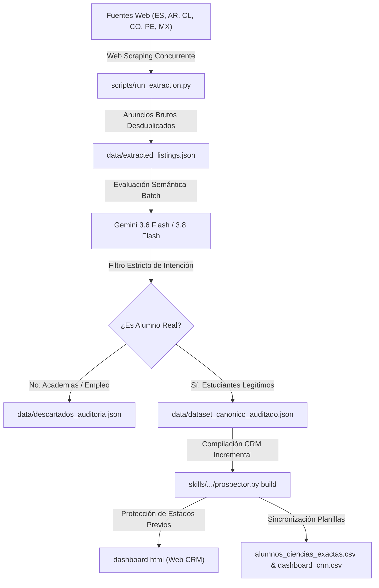

# Sistema Autónomo de Prospección con IA y CRM de Alumnos (Ciencias Exactas)

[](https://aistudio.google.com/)
[](#suite-de-pruebas-automatizadas)
[](https://www.python.org/)
[](LICENSE)
[](#)

Sistema integral de ingeniería de datos, web scraping concurrente, filtrado semántico con modelos de lenguaje multimodal (**Google Gemini 3.6 Flash / 3.8 Flash**) y panel CRM interactivo autónomo (**`dashboard.html`**) para la captación, filtrado y gestión de alumnos en materias de ciencias exactas (**Matemáticas, Física, Química y Biología**) para nivel secundario, técnico y universitario en España e Hispanoamérica (Argentina, Chile, Colombia, México, Perú).

Diseñado a medida para la propuesta pedagógica del **Prof. Alejo Ongaro** (más de 18 años de experiencia docente, estudiante de Biología Molecular, modalidad **100% Online / Virtual**).

---

## 🚀 Características Principales

1. **Rastreador Web en Vivo (Web Scraping)**:
   - Extrae automáticamente solicitudes y demandas reales (`?demanda=1`, `/estudiantes/`) en portales educativos líderes:
     - **TusClases**: Red en España, Argentina, Chile, Colombia, México y Perú.
     - **Tablón de Anuncios**: Tablones de demanda escolar y universitaria en España.
     - **Cronoshare**: Solicitudes de clases particulares con advertencia explícita de barrera de créditos.
     - **Reddit**: Comunidades de estudiantes y búsqueda de empleo académico (`r/empleos_AR`).
2. **Auditoría Semántica con IA (Gemini 3.6 / 3.8 Flash)**:
   - Resuelve el problema asimétrico de los clasificados (donde el 90% son ofertas de trabajo o academias buscando docentes).
   - Discrimina mediante JSON forzado (`responseMimeType: "application/json"`) si el autor es un alumno/padre real o un instituto/academia.
   - Explica de forma transparente cada decisión en el campo `Criterio_IA`.
3. **Panel CRM Interactivo Desconectado (`dashboard.html`)**:
   - Funciona 100% en el navegador sin dependencias de backend, con Tailwind CSS y persistencia segura en `localStorage` (con fallback de memoria).
   - Generación de saludo hiperpersonalizado: extrae el nombre del alumno (`¡Hola Sebastián!`, `¡Hola Valentina!`).
   - Flujo comercial seguro desacoplado: botón de copia rápida `📋 Copiar & Abrir` separado de la confirmación `✓ Confirmar Envío`. Si un prospecto está en estado `Cerrado`, nunca sufre regresión a `Contactado`.
   - Copias de seguridad completas: botones integrados de `💾 Respaldo JSON` y `📂 Restaurar` para no perder notas ni cambios al cambiar de equipo.
4. **Ejecutor Seguro de Un Clic (`Actualizar_Alumnos.bat`)**:
   - Puente nativo en Windows para correr el scraping, consultar a Gemini, inyectar los nuevos prospectos como `🆕 Nuevo` preservando el historial y recargar Chrome automáticamente.

---

## 🏛️ Arquitectura del Pipeline



---

## 📁 Estructura del Repositorio

```text
├── Actualizar_Alumnos.bat         # Lanzador ejecutable nativo de 3 pasos para Windows
├── dashboard.html                 # Aplicación web CRM interactiva autónoma (HTML5/Tailwind/JS)
├── alumnos_ciencias_exactas.csv   # Base de datos canónica tabular con BOM UTF-8 y protección anti-fórmula
├── dashboard_crm.csv              # Planilla operativa CRM para importación en Google Sheets / Excel
├── check_dashboard.cjs            # Suite de pruebas automatizadas en Node.js (16 escenarios de auditoría)
├── DOCUMENTACION_TECNICA_PROYECTO.md # Documento técnico de especificación, seguridad y hashes SHA-256
├── Conclusiones_del_Proyecto.md   # Conclusiones comerciales, operativas y estrategia de captación
├── directorio_plataformas.md      # Análisis comparativo de los 10 portales evaluados
├── AUDITORIA_PARA_ANTIGRAVITY.md  # Informe de la auditoría externa independiente (Hallazgos A01-A11)
├── data/
│   ├── dataset_canonico_auditado.json # 41 publicaciones aprobadas (39 estudiantes únicos)
│   ├── descartados_auditoria.json     # Registro de academias y ofertas rechazadas por la IA
│   └── extracted_listings.json        # Datos brutos de la extracción web
├── scripts/
│   ├── run_extraction.py          # Orquestador del scraping concurrente
│   ├── extract_tusclases.py       # Scraper para red TusClases (6 países)
│   ├── extract_tablon.py          # Scraper de Tablón de Anuncios (?demanda=1)
│   ├── extract_cronoshare_workana.py # Scraper de Cronoshare y Reddit
│   └── common_filter.py           # Validadores de estructura y verificación HTTP de enlaces
└── skills/
    └── prospeccion-alumnos-ciencias/
        ├── SKILL.md               # Definición de la Skill de prospección para Antigravity / Gemini CLI
        ├── references/            # Prompts y directrices de auditoría
        └── scripts/
            └── prospector.py      # CLI unificado (comandos: audit, build, run)
```

---

## 🛠️ Requisitos e Instalación

### Requisitos Previos
- **Windows 10 / 11** (o Linux/macOS adaptando los scripts shell).
- **Python 3.10 o superior** (asegúrate de marcar *"Add Python to PATH"* durante la instalación).
- **Google Gemini API Key** (gratuita en [Google AI Studio](https://aistudio.google.com/app/apikey)).

### Configuración de la Clave de API
Puedes cargar tu clave de API de cualquiera de estas tres formas:
1. **Variable de entorno de Windows**:
   ```cmd
   setx GEMINI_API_KEY "tu_clave_aqui"
   ```
2. **Archivo `.env` en la raíz del proyecto**:
   ```env
   GEMINI_API_KEY=tu_clave_aqui
   ```
3. **Por consola interactiva**: Si no está configurada, [Actualizar_Alumnos.bat](Actualizar_Alumnos.bat) te la pedirá directamente en pantalla al ejecutarse.

---

## 💻 Uso del Sistema

### 1. Gestión Diaria
Abre [dashboard.html](dashboard.html) en tu navegador preferido (Google Chrome, Edge, Firefox, Brave). El CRM funciona sin conexión:
- Filtra por **País**, **Materia**, **Modalidad** o **Nivel Educativo**.
- Haz clic en **`📋 Copiar & Abrir`** para copiar la carta personalizada al portapapeles y abrir el anuncio del alumno en una nueva pestaña.
- Una vez contactado, haz clic en **`✓ Confirmar Envío`** para actualizar su estado a *Contactado*.
- Descarga tu respaldo con **`💾 Respaldo JSON`**.

### 2. Escaneo y Actualización de Nuevos Alumnos
Haz **doble clic en `Actualizar_Alumnos.bat`**:
1. Conectará con los portales web y extraerá nuevas publicaciones.
2. Gemini 3.6 Flash auditará y descartará academias.
3. Se recompilarán [dashboard.html](dashboard.html) y las planillas, protegiendo todos los estados que ya hayas gestionado.
4. Tu navegador se abrirá automáticamente con los nuevos prospectos.

---

## 🧪 Suite de Pruebas Automatizadas

El proyecto incluye un arnés de pruebas riguroso ([check_dashboard.cjs](check_dashboard.cjs)) que valida el 100% de los requerimientos de seguridad, almacenamiento e integridad:

```bash
node check_dashboard.cjs
```

### Resultados de la Auditoría (16/16 Tests Passing):
* `initial`: Valida coincidencia exacta de registros entre HTML y CSV.
* `country_filter`: Valida cálculo dinámico de métricas por país.
* `subject_includes_combined`: Valida búsquedas de materias compuestas (Matemática + Física).
* `empty_filter`: Manejo seguro de filtros sin resultados.
* `shared_cronoshare_id`: Confirma inmutabilidad de identificadores únicos en Cronoshare.
* `clipboard_denied_contacted` & `clipboard_absent`: Integridad de estados ante bloqueos de portapapeles.
* `popup_blocked_contacted`: No altera estados si el navegador bloquea pestañas emergentes.
* `closed_regression`: Garantiza que prospectos en estado `Cerrado` jamás sufran regresión a `Contactado`.
* `export`: Exportación con codificación UTF-8 BOM (`\uFEFF`) y columnas de auditoría.
* `storage_null`, `storage_invalid_json`, `storage_denied`: Resiliencia total ante fallos de `localStorage` con fallback en memoria.
* `placeholder_repeated`: Valida reemplazo de variables múltiples (`replaceAll`).
* `apostrophe_inline_handler`: Cero atributos `onclick` interpolados con cadenas crudas.
* `unescaped_html_sink`: Protección estricta contra inyección de código (XSS) y neutralización de inyección de fórmulas CSV (`=+-@`).

---

## 🔒 Seguridad y Privacidad

- **Protección contra Fórmulas Maliciosas en CSV**: Todo campo de texto que inicie con `=`, `+`, `-` o `@` es neutralizado automáticamente anteponiendo `'` para impedir ejecución arbitraria en Excel.
- **Escape de Entidades HTML**: Todo dato dinámico pasa por saneamiento estricto (`escapeHTML()`) antes de ser inyectado en el DOM.
- **Sin Dependencias Inseguras**: El pipeline central utiliza exclusivamente la biblioteca estándar de Python y scripts Node.js sin frameworks externos vulnerables.

---

## 📄 Licencia

Este proyecto está bajo la Licencia MIT. Consulta el archivo [LICENSE](LICENSE) para más detalles.
