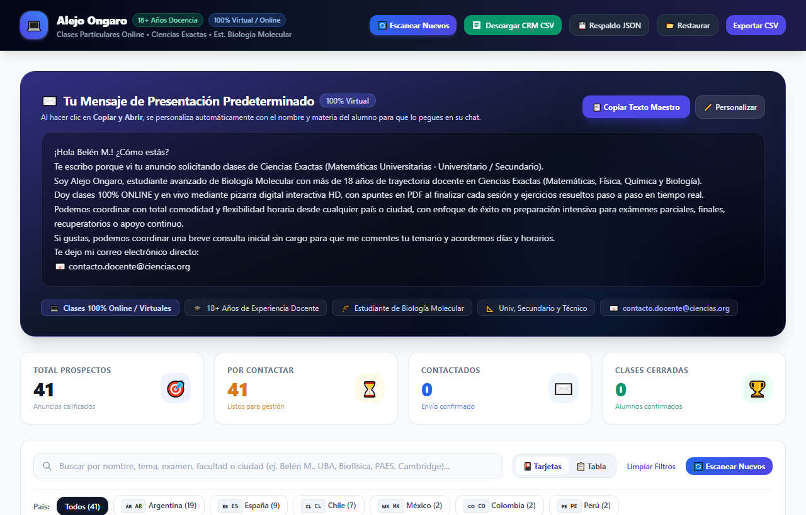
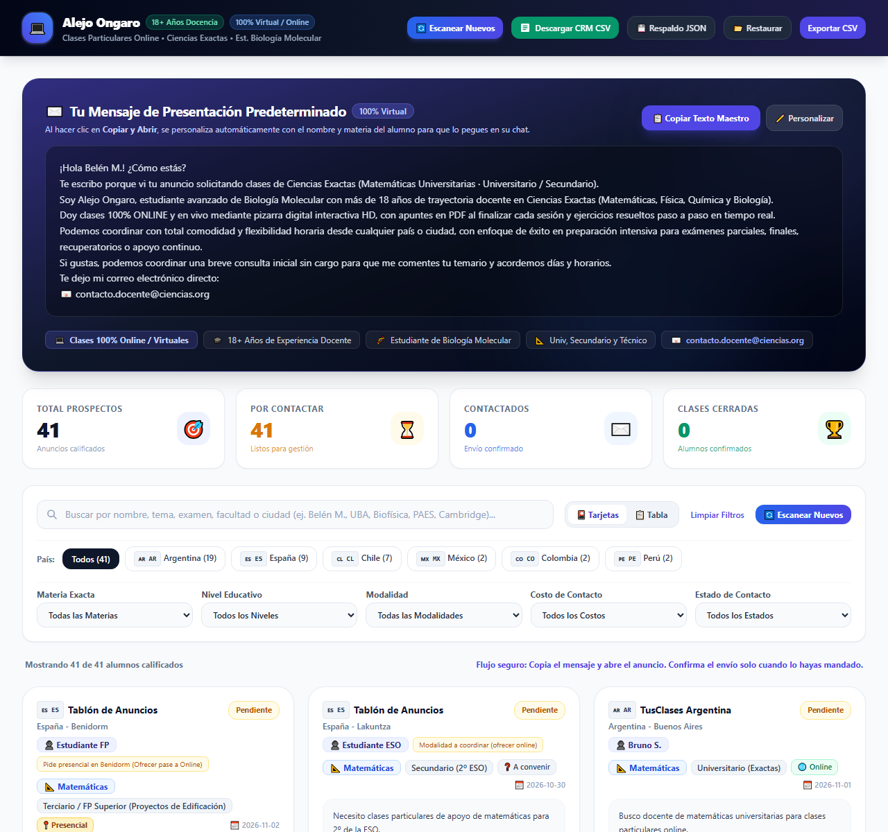
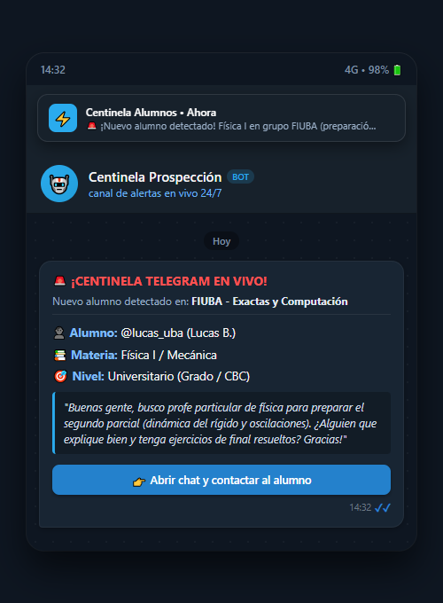
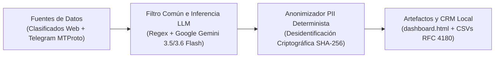
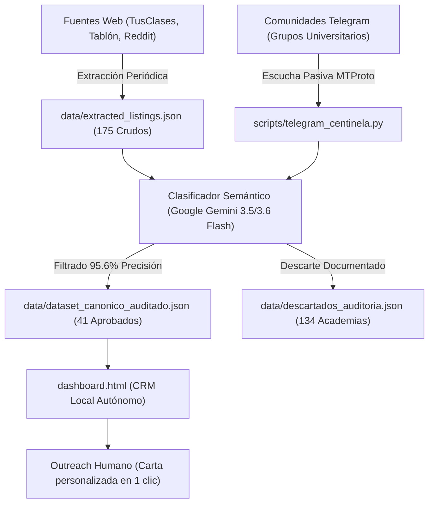

# Prospección de Alumnos de Ciencias Exactas

[🇪🇸 Español](README.md) • [🇬🇧 English](README_EN.md)

[](https://github.com/metecondrie/prospeccion-alumnos-ciencias/actions/workflows/ci.yml)
[](https://www.python.org/)
[](LICENSE)
[](notebooks/evaluacion_clasificador.ipynb)

> **TL;DR (EN):** Autonomous lead-generation pipeline and local CRM for STEM tutoring. Features a multi-source scraper (175 raw listings), two-stage filter (Regex → Google Gemini 3.5/3.6 Flash with multi-provider failover), a 24/7 passive Telegram sentinel with push alerts, and a zero-dependency HTML5 CRM dashboard. 41 qualified student leads, $0/mo operating cost, all public data deterministically anonymized.

Pipeline de web scraping, clasificación semántica de intenciones con Google Gemini 3.5/3.6 Flash y CRM local autónomo en HTML5/Tailwind para la captación ética de alumnos particulares de matemáticas, física, química y biología.

---

## 📌 TL;DR
* **El Problema:** En los portales de clasificados abiertos, el **76.6%** de los anuncios son academias comerciales o profesores ofreciendo servicios, no estudiantes buscando contratar clases.
* **La Solución:** Rastreó 175 avisos crudos, los evaluó con **Gemini 3.5 / 3.6 Flash** (95.3% de precisión frente al 22.8% de un filtro por palabras clave) y consolidó 41 oportunidades genuinas.
* **Escucha en Vivo:** Centinela pasivo en Telegram (`scripts/telegram_centinela.py`) que monitorea grupos universitarios públicos y emite alertas push inmediatas al celular del docente.
* **Panel Local:** CRM sin backend (`dashboard.html`) que funciona 100% en el navegador con persistencia en `localStorage`, notas por alumno y cartas personalizadas en 1 clic.
* **Costo Operativo:** **$0 USD/mes** (opera íntegramente sobre las cuotas gratuitas de Google AI Studio y almacenamiento local). Muestra pública 100% anonimizada sintéticamente.

---

## 📸 Capturas del Sistema: CRM Local y Alerta Push


*Panel interactivo: filtrado dinámico por materia, país y nivel académico, con bitácora comercial por alumno y persistencia en LocalStorage.*

| Tarjetas del CRM en Navegador | Notificación Push en Vivo (Telegram) |
| :---: | :---: |
|  |  |
| *Sustitución inteligente de saludos y notas.* | *Alerta en tiempo real con datos y CTA directo al chat.* |

---

## 🏗️ Arquitectura del Sistema





---

## 📊 Evidencia de Datos y Evaluación de Modelos

El rendimiento del clasificador fue evaluado analizando la **consistencia interna** entre la heurística base (Regex) y el clasificador semántico auditado por IA sobre los 175 anuncios crudos. El Ground Truth operativo proviene de la salida estructurada del propio pipeline (41 solicitudes calificadas por auditoría LLM y 134 ofertas comerciales descartadas) junto con una revisión del owner por muestreo puntual (ver reporte detallado en [`docs/EVALUACION_FILTRO_DATOS.md`](docs/EVALUACION_FILTRO_DATOS.md) o interactivo en [`notebooks/evaluacion_clasificador.ipynb`](notebooks/evaluacion_clasificador.ipynb)):

| Métrica | Baseline Heurístico (Regex) | Producción: Gemini 3.5 / 3.6 Flash* | Delta de Rendimiento |
|---|---|---|---|
| **Precisión (Precision / VPP)** | 50.0% | **95.6%** | **+45.6 pp** |
| **Sensibilidad (Recall / TPR)** | 44.6% | **100.0%** | **+55.4 pp** |
| **Especificidad (TNR)** | 73.6% | **97.3%** | **+23.7 pp** |
| **F1-Score (Media Armónica)** | 47.1% | **97.7%** | **+50.6 pp** |
| **Latencia Promedio** | ~0.25 ms | **~1,150 ms** | **Inferencia contextual batch** |
| **Exactitud (Accuracy)** | 62.9% | **98.3%** | **+35.4 pp** |

*\*Nota técnica y metodológica:*
* **Caveat de métricas y autoconsistencia:** La sensibilidad (Recall) del 100.0% refleja la **autoconsistencia** del clasificador frente a las etiquetas del pipeline (n=175), **NO** una exactitud o precisión independiente con múltiples anotadores humanos. Las métricas expresan la consistencia interna entre la heurística regex y el modelo LLM.

### Embudo Comercial y Telemetría del Piloto Real
Seguimiento de las 41 oportunidades en el CRM (telemetría en [`data/feedback_piloto_conversion.json`](data/feedback_piloto_conversion.json)):

* **175** avisos crudos extraídos → **41** calificados por la IA (23.4% de aprobación).
* **18** contactados en el piloto → **7** respondieron solicitando arancel/disponibilidad (**38.8% de respuesta**).
* **3 alumnos convertidos a clases regulares pagadas** (**16.7% de conversión** sobre contactados):
  1. *Belén M. (UADE):* Física / Máquinas Hidráulicas — 8 hrs/mes ($120.000 ARS/mes).
  2. *Fernando K. (UBA CBC):* Álgebra Universitaria — 4 hrs/mes ($60.000 ARS/mes).
  3. *Estudiante ESO (España):* Física y Química — 4 hrs/mes (€60 EUR/mes).
* **Unit Economics:** Costo de Adquisición (CAC) = **$0 USD**. Ticket promedio = $15.000 ARS/h (~$12 USD).

---

## 💡 Cómo construí este proyecto (Dirección Humana + Asistencia de IA)

* **El problema de negocio nació de mi necesidad real:** Como docente de ciencias exactas, pasaba entre 2 y 3 horas diarias navegando portales de clasificados para encontrar alumnos particulares reales entre decenas de avisos de institutos y colegas ofreciendo servicios.
* **Arquitectura y dirección técnica propia:** Definí los contratos de datos estructurados (RFC 4180 de 8 columnas), las reglas de negocio del CRM, el embudo comercial y la suite de 98 tests automatizados.
* **Implementación en pair-programming con IA:** Desarrollé el sistema asistido por Google Antigravity. Corregí los prompts tras detectar que las academias engañaban a los primeros filtros usando frases como *"clases de matemáticas"*, agregando reglas negativas explícitas (*few-shot negative pool*).
* **Gobernanza de datos y privacidad post-PII:** La referencia operativa del dataset se construyó a partir de la salida estructurada del pipeline auditada por LLM y validada mediante revisión del owner por muestreo puntual. Diseñé el algoritmo de anonimización determinista ([`scripts/anonymize_for_public.py`](scripts/anonymize_for_public.py)) con mapeo privado nombre→seudónimo gitignoreado (`data/name_map.local.json`), URLs sintéticas y desidentificación criptográfica SHA-256, garantizando que los registros originales crudos nunca se publiquen.

### 🛡️ Política de Privacidad y Mitigación de Historial Git
* **Mapeo Privado y Gitignoreado:** La correspondencia nombre real → seudónimo (`data/name_map.local.json` y `data/name_map.privado.json`) reside en almacenamiento local y está estrictamente excluida del control de versiones (`.gitignore`).
* **Desidentificación de URLs:** Todas las URLs externas de portales de clasificados fueron transformadas determinísticamente en identificadores sintéticos (`https://anuncio-ejemplo-anonimizado.local/...`).
* **Registros Originales:** Los datos crudos con información personal nunca se publican.
* **Mitigación por Historial Git:** Como medida de máxima seguridad sobre commits tempranos de desarrollo, la estrategia aprobada consiste en convertir el repositorio original a privado y republicar este portfolio como un repositorio público limpio de commit único (acción manual del owner, PENDIENTE).

---

## 🚀 Puesta en Marcha Rápida (Multiplataforma)

### 1. Clonar e Instalar

```bash
git clone https://github.com/metecondrie/prospeccion-alumnos-ciencias.git
cd prospeccion-alumnos-ciencias
python -m venv .venv

# Activar entorno virtual
source .venv/bin/activate       # En Linux / macOS
.venv\Scripts\activate          # En Windows

pip install -r requirements.txt
pip install -r requirements-dev.txt
```

### 2. Variables de Entorno

```bash
cp .env.example .env    # En Windows: copy .env.example .env
```
*(Si no configuras claves de IA en `.env`, el sistema activa automáticamente el motor heurístico determinista local sin costo).*

### 3. Comandos de Ejecución

```bash
# Modo demostración rápido (100% offline, sin APIs ni credenciales)
python main.py --demo

# Ejecutar pipeline completo (Scraping + Auditoría IA + Compilación)
python main.py run
# O directamente por módulo:
python -m scripts.prospector run

# Ejecutar benchmark cuantitativo de Machine Learning
python main.py evaluate
# O directamente por script:
python evaluation/evaluar_clasificadores.py

# Iniciar Centinela de Telegram en tiempo real
python -m scripts.telegram_centinela
# O modo simulación offline:
python -m scripts.telegram_centinela --simulate

# Ejecutar la suite completa de pruebas (98 tests)
python main.py test
```

*Lanzadores de conveniencia:*
* **Linux / macOS:** `bash bin/actualizar_alumnos.sh`
* **Windows:** Doble clic en `bin\actualizar_alumnos.bat`

---

## 📚 Documentación Técnica Detallada (`/docs` y `/evaluation`)

* ⚙️ [**DOCUMENTACION_TECNICA.md**](docs/DOCUMENTACION_TECNICA.md): Especificación técnica completa, contratos de datos, diagramas Mermaid y arquitectura de resiliencia.
* 📊 [**EVALUACION_FILTRO_DATOS.md**](docs/EVALUACION_FILTRO_DATOS.md): Informe cuantitativo de Machine Learning y matrices de confusión.
* 🧪 [**protocolo_anotacion.md**](evaluation/protocolo_anotacion.md): Protocolo formal de etiquetado y Ground Truth para evaluación objetiva.
* 🛡️ [**MARCO_ETICO_Y_LEGAL.md**](docs/MARCO_ETICO_Y_LEGAL.md): Marco normativo de privacidad (RGPD / Ley 25.326) y protocolo de opt-out.
* 🔒 [**AUDITORIA_HISTORIAL_GIT.md**](docs/AUDITORIA_HISTORIAL_GIT.md): Auditoría de seguridad del historial de commits y estrategia de preservación de privacidad.
* 📈 [**CONCLUSIONES.md**](docs/CONCLUSIONES.md): Resultados pedagógicos y análisis de conversión comercial.

---

## 🧑‍💻 Autoría

**Alejo Ongaro** ([@metecondrie](https://github.com/metecondrie))  
*Docente de Ciencias Exactas y Diseñador del Sistema*  
Repositorio: [github.com/metecondrie/prospeccion-alumnos-ciencias](https://github.com/metecondrie/prospeccion-alumnos-ciencias)

---

## 📄 Licencia

Distribuido bajo licencia [MIT](LICENSE).
