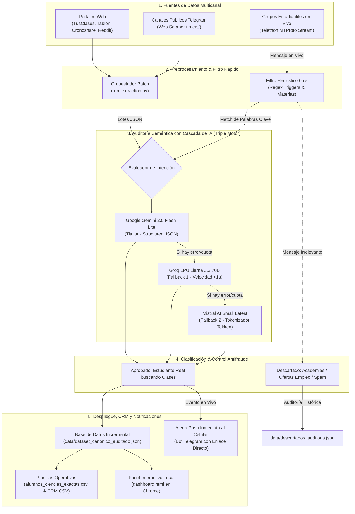
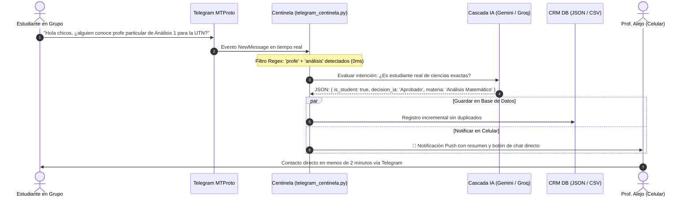
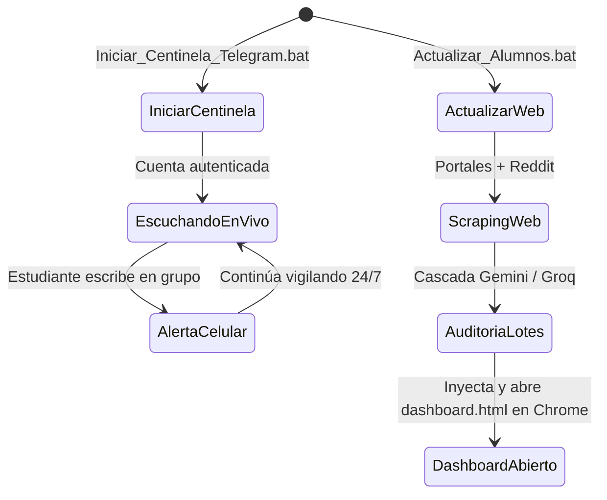

# 🎓 Sistema Autónomo de Prospección con IA, Centinela Telegram 24/7 y CRM de Alumnos (Ciencias Exactas)

<p align="center">
  
  
  
  
  
</p>

---

## 📌 Visión General del Proyecto

Plataforma inteligente de ingeniería de datos, **escucha en tiempo real (MTProto)**, web scraping concurrente, auditoría semántica con **Triple Motor de Inteligencia Artificial (Google Gemini Flash Lite + Groq LPU + Mistral AI)** y panel de gestión comercial (**CRM interactivo `dashboard.html`**).

El sistema fue diseñado a la medida de la propuesta pedagógica del **Prof. Alejo Ongaro**:
* **Trayectoria:** Más de 18 años de experiencia docente universitaria y secundaria. Formación en Biología Molecular y Ciencias Exactas.
* **Especialidades:** Matemática, Física, Química, Biología, Biofísica, Álgebra, Análisis Matemático, CBC UBA, UTN, UNLP.
* **Modalidad:** 100% Online / Virtual para Argentina y Latinoamérica (con soporte en España).
* **Costo Operativo:** **$0 USD / mes** (100% en capas gratuitas oficiales de Google AI Studio, Groq Cloud, Mistral AI y Telegram Bot API).

---

## ⚡ Novedades Principales (Versión 4.0)

1. **🚨 Centinela Telegram en Tiempo Real 24/7 (`telegram_centinela.py`):**
   * Escucha continua por eventos en streaming (sin llamadas repetitivas o polling) en todos los grupos y comunidades estudiantiles donde el usuario sea miembro.
   * **Filtro de dos etapas:** 
     1. Heurística Regex a 0ms (descarta mensajes irrelevantes o charlas comunes sin costo computacional).
     2. Auditoría semántica con IA en 500ms para confirmar la intención del estudiante.
   * **Alertas Push Instantáneas:** Envío inmediato de la ficha del alumno a tu chat privado de Telegram con un botón directo (`tg://user?id=...` o `@usuario`) para escribirle en el acto.
   * **Latido en Pantalla (Heartbeat) y Caja Negra:** Muestra un pulso visual cada 60s con estadísticas en vivo y registra cada detección en `logs/centinela.log`.

2. **🛡️ Filtro de Liveness Inteligente (`auto_join_groups.py`):**
   * Audita la fecha del último mensaje público de cada grupo antes de unirse.
   * **Descarta grupos "fantasmas" o inactivos** (última actividad > 60 días) para no saturar tu cuenta ni activar límites de Telegram.
   * Manejo transparente y seguro de pausas (*FloodWait protection*).

3. **🕸️ Scraper Web Multicanal Ampliado (170+ avisos concurrentes):**
   * Extracción periódica de demandas estudiantiles reales (`?demanda=1`, `/estudiantes/`, RSS):
     * **TusClases:** Red en Argentina, España, México, Colombia, Chile y Perú.
     * **Tablón de Anuncios:** Demandas de bachillerato y clases universitarias.
     * **Cronoshare:** Peticiones con discriminación de coste por contacto.
     * **Reddit:** Comunidades universitarias (`r/UBA`, `r/empleos_AR`, `r/Cordoba`).
     * **Telegram Web Channels:** Extracción de canales públicos sin login vía `https://t.me/s/`.

4. **📊 Dashboard CRM Reactivo (`dashboard.html`):**
   * Persistencia local segura en `localStorage` con bitácora de notas, WhatsApp, precios pactados y fechas de seguimiento.
   * Buscador insensible a acentos (NFD) y filtrado estricto por nivel educativo (Universitario, Secundario, Terciario).

---

## 🏛️ Arquitectura del Sistema

El pipeline combina procesamiento por lotes (Batch) para la web y procesamiento reactivo continuo (Stream) para mensajería instantánea.

### 1. Diagrama de Flujo Integral



---

### 2. Diagrama de Secuencia: Detección en Vivo con el Centinela



---

## 🎯 Criterios de Auditoría con Inteligencia Artificial

Para evitar el problema habitual donde más del 80% de los anuncios de internet son falsos positivos, la IA aplica reglas estrictas:

| Criterio | Acción de la IA | Ejemplos Detectados y Excluidos |
| :--- | :---: | :--- |
| **Estudiante o Padre buscando profesor** | ✅ **Aprobado** | *"Busco profe de Física para preparar final de la FIUBA"*, *"Necesito apoyo en Química para mi hijo de 4to año"*. |
| **Academia / Instituto privado** | ❌ **Descartado** | *"Academia Centro Universitario abre inscripciones a curso intensivo"*, *"Precios promocionales en nuestro instituto"*. |
| **Oferta laboral / Empleo docente** | ❌ **Descartado** | *"Colegio privado busca docente de Matemática para ciclo básico"*, *"Se busca profesor suplente turno tarde"*. |
| **Profesor ofreciendo sus clases** | ❌ **Descartado** | *"Doy clases particulares de Álgebra y Geometría, 15 años de experiencia"*, *"Profesor particular a domicilio"*. |
| **Materia fuera de Ciencias Exactas** | ❌ **Descartado** | Clases de inglés, guitarra, historia, programación web o marketing. |

---

## 👥 Comunidades Estudiantiles Monitoreadas en Telegram

El sistema se conecta a grupos y canales públicos verificados por el filtro de liveness:

```text
├── Grupos de Discusión en Vivo (Vigilancia Activa de Consultas):
│   ├── [UTN FRBA]        @ingresoutnfrba            (329 miembros)
│   ├── [FIUBA]           @QuimicaFIUBA              (207 miembros)
│   ├── [FIUBA]           @ASTAR_fiuba               (156 miembros)
│   ├── [Universitarios]  @us21_analisis_matematico  (500 miembros)
│   ├── [Universitarios]  @analisismatematicoi       (130 miembros)
│   ├── [UNLP La Plata]   @chatUNLP                  (93 miembros)
│   ├── [UNLP Medicina]   @IngMedUNLP2023            (104 miembros)
│   └── [CBC UBA]         @cbcalumnos                (36 miembros)
│
└── Canales de Noticias y Materiales (Extracción Web):
    ├── @universidad_nacional_de_laplata             (1.352 miembros)
    ├── @FIUBA_Noticias                              (690 miembros)
    └── @cbcubamateriales                            (105 miembros)
```

---

## 📋 Formato de la Alerta en tu Celular

Cuando el Centinela aprueba un alumno, recibes una notificación en tu bot personal (`@alejo_ciencias_alumnos_bot`):

```text
🚨 ¡CENTINELA TELEGRAM EN VIVO!
Nuevo alumno detectado en el grupo: Ingreso - UTN FRBA (Matemática y Física)

👤 Alumno: @lucas_utn26
📚 Materia: Análisis Matemático
🎯 Nivel: Universitario (Ingreso / Grado)

💬 Mensaje: "Buenas tardes, me cuesta un montón la parte de derivadas e integrales de la guía 3. ¿Algún profe que dé clases virtuales este fin de semana?"

👉 [Abrir chat y contactar al alumno]
```

---

## 💻 Guía Rápida de Uso en Windows

El sistema cuenta con ejecutables nativos `.bat` para operar en un clic:



1. **Para activar el vigilante en tiempo real:**
   * Doble clic en `Iniciar_Centinela_Telegram.bat`.
   * Podés **minimizar** la ventana (con la raya `_`). Queda corriendo en segundo plano y te reporta el latido cada 60s.
2. **Para actualizar todos los portales web (TusClases, Tablón, Cronoshare, Reddit):**
   * Doble clic en `Actualizar_Alumnos.bat`.
   * En 30 segundos busca, audita y abre automáticamente `dashboard.html` en Chrome con los prospectos listos.
3. **Para explorar o gestionar prospectos:**
   * Abrí `dashboard.html` directamente con tu navegador favorito.

---

## ⚙️ Estructura del Proyecto

```text
├── Iniciar_Centinela_Telegram.bat     # Lanzador del bot Centinela 24/7
├── Actualizar_Alumnos.bat             # Lanzador del ciclo completo de scraping web y CRM
├── Unirme_A_Grupos_Estudiantes.bat    # Conector inteligente a grupos con filtro de actividad
├── dashboard.html                     # Aplicación Web CRM interactiva (Tailwind CSS)
├── alumnos_ciencias_exactas.csv       # Base de datos canónica tabular (BOM UTF-8, anti-fórmula)
├── dashboard_crm.csv                  # Planilla adaptada para Google Sheets / Excel
├── validate_dataset.py                # Validador determinista de integridad del dataset
├── requirements.txt                   # Dependencias de Python (telethon, requests, google-genai, etc.)
│
├── data/
│   ├── dataset_canonico_auditado.json # Dataset principal acumulativo de alumnos aprobados
│   ├── descartados_auditoria.json     # Historial de falsos positivos y academias filtradas
│   ├── extracted_listings.json        # Extracciones web crudas
│   └── telegram_channels.json         # Directorio de grupos y canales auditados
│
├── logs/
│   └── centinela.log                  # Registro cronológico continuo de detecciones del Centinela
│
└── scripts/
    ├── telegram_centinela.py          # Cliente MTProto en streaming con IA en vivo y push
    ├── auto_join_groups.py            # Validador de liveness y auto-join con rate-limit
    ├── prospector.py                  # CLI central del motor de IA y compilador del dashboard
    ├── run_extraction.py              # Orquestador concurrente de scrapers web
    ├── extract_tusclases.py           # Scraper para red TusClases (6 países)
    ├── extract_tablon.py              # Scraper de Tablón de Anuncios
    ├── extract_cronoshare_workana.py  # Scraper de Cronoshare y Reddit RSS
    └── extract_telegram.py            # Scraper de vistas web de canales públicos
```

---

## 🔒 Seguridad y Privacidad

* Las credenciales personales (`TELEGRAM_API_ID`, `TELEGRAM_API_HASH`, `TELEGRAM_BOT_TOKEN`, `GEMINI_API_KEY`) y la sesión (`centinela_session.session`) están estrictamente protegidas mediante `.gitignore` y variables en `.env`.
* No se guardan ni transmiten contraseñas en texto plano.
* Los archivos exportados para Excel están protegidos contra inyecciones de fórmulas maliciosas (`=`, `+`, `-`, `@`).

---

## 📄 Licencia

Desarrollado bajo licencia **MIT** para el **Prof. Alejo Ongaro**. Libre de costos de licenciamiento o infraestructura de pago.
