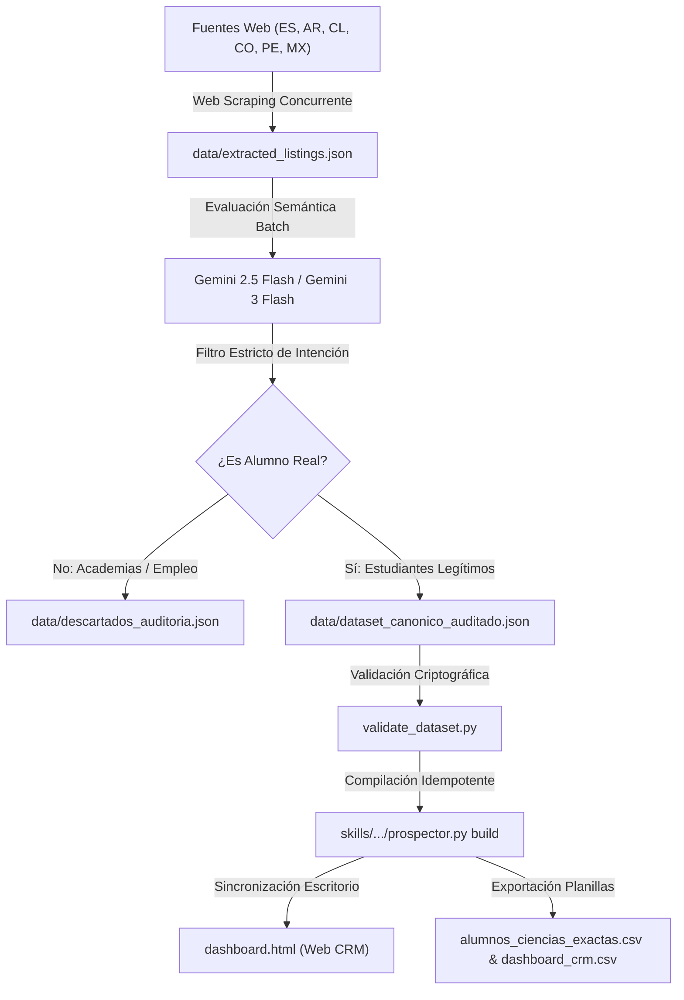

# Sistema Autónomo de Prospección con IA y CRM de Alumnos (Ciencias Exactas)

[](https://aistudio.google.com/)
[](#validación-y-pruebas-automatizadas)
[](https://www.python.org/)
[](LICENSE)
[](#)

Sistema integral de ingeniería de datos, web scraping concurrente, filtrado semántico con modelos de lenguaje (**Google Gemini 2.5 Flash / Gemini 3 Flash Preview**) y panel CRM interactivo autónomo (**`dashboard.html`**) para la captación, filtrado y gestión de alumnos en materias de ciencias exactas (**Matemáticas, Física, Química y Biología**) para nivel secundario, técnico y universitario en España e Hispanoamérica (Argentina, Chile, Colombia, México, Perú).

Diseñado a medida para la propuesta pedagógica del **Prof. Alejo Ongaro** (más de 18 años de experiencia docente, estudiante de Biología Molecular, modalidad **100% Online / Virtual**).

---

## 🚀 Características Principales

1. **Rastreador Web en Vivo (Web Scraping)**:
   - Extrae automáticamente solicitudes y demandas reales (`?demanda=1`, `/estudiantes/`) en portales clasificados:
     - **TusClases**: Red en España, Argentina, Chile, Colombia, México y Perú.
     - **Tablón de Anuncios**: Tablones de demanda escolar y universitaria en España.
     - **Cronoshare**: Solicitudes con categorización transparente de créditos (Cronos).
     - **Reddit**: Comunidades de estudiantes y búsqueda de empleo académico (`r/empleos_AR`).
2. **Auditoría Semántica con IA (Gemini 2.5 / 3 Flash)**:
   - Resuelve el problema asimétrico de los clasificados (donde el 90% son ofertas de trabajo o academias buscando docentes).
   - Discrimina en formato estructurado JSON (`responseMimeType: "application/json"`) si el autor es un estudiante/padre real o un instituto/academia.
   - Explica de forma transparente cada decisión en el campo `Criterio_IA`.
3. **Panel CRM Interactivo (`dashboard.html`)**:
   - Funciona autónomamente en el navegador con Tailwind CSS y persistencia segura en `localStorage` (con fallback de memoria).
   - **Buscador sin acentos (Normalización Unicode NFD)**: Buscar "hernan", "cordoba", "peru", "matematicas" encuentra sus respectivos avisos.
   - **Filtro estricto por nivel educativo**: "Universitario" devuelve exactamente 16 prospectos puros sin mezclar con pre-universitarios.
   - **Bitácora y Notas CRM por lead**: Modal para registrar notas, WhatsApp, precio acordado, próximas fechas de seguimiento y confirmación de respuesta.
   - **Tratamiento honesto de Cronoshare**: Botón diferenciado `🔍 Buscar en Cronoshare (Requiere Créditos)` con tooltip explicativo y sin sobrescribir el portapapeles.
   - **Flujo de contacto seguro**: Botón `📋 Copiar & Abrir` separado de la confirmación `✓ Confirmar Envío`. Si un prospecto está en estado `Cerrado`, nunca sufre regresión a `Contactado`.
   - **Copias de seguridad**: Botones de `💾 Respaldo JSON` y `📂 Restaurar` para no perder notas ni cambios al cambiar de equipo.
4. **Ejecutor Seguro de Un Clic (`Actualizar_Alumnos.bat`)**:
   - Puente nativo en Windows para correr el scraping, consultar a Gemini, validar la integridad determinista del dataset, inyectar los prospectos y recargar el Dashboard en Chrome.

---

## 🏛️ Arquitectura del Pipeline



---

## 📁 Estructura del Repositorio

```text
├── Actualizar_Alumnos.bat         # Lanzador ejecutable nativo de 3 pasos para Windows
├── dashboard.html                 # Aplicación web CRM interactiva (HTML5/Tailwind/JS)
├── alumnos_ciencias_exactas.csv   # Base de datos canónica tabular con BOM UTF-8 y protección anti-fórmula
├── dashboard_crm.csv              # Planilla operativa CRM para importación en Google Sheets / Excel
├── check_dashboard.cjs            # Suite de pruebas automatizadas en Node.js (Aserciones estrictas)
├── validate_dataset.py            # Validador determinista de integridad de datos y URLs
├── requirements.txt               # Dependencias de Python requeridas
├── .env.example                   # Plantilla para configuración de GEMINI_API_KEY
├── DOCUMENTACION_TECNICA_PROYECTO.md # Documento técnico de especificación, seguridad y hashes SHA-256
├── Conclusiones_del_Proyecto.md   # Conclusiones comerciales, operativas y estrategia de captación
├── directorio_plataformas.md      # Análisis comparativo de los 10 portales evaluados
├── data/
│   ├── dataset_canonico_auditado.json # 41 publicaciones aprobadas (38 estudiantes únicos)
│   ├── descartados_auditoria.json     # Registro de academias y ofertas rechazadas por la IA
│   └── extracted_listings.json        # Datos brutos de la extracción web
├── scripts/
│   ├── run_extraction.py          # Orquestador del scraping concurrente
│   ├── extract_tusclases.py       # Scraper para red TusClases (6 países)
│   ├── extract_tablon.py          # Scraper de Tablón de Anuncios (?demanda=1)
│   ├── extract_cronoshare_workana.py # Scraper de Cronoshare y Reddit
│   └── common_filter.py           # Validadores de estructura y verificación HTTP de enlaces
└── skills/
    └── prospeccion-alumnos-ciencias/
        ├── SKILL.md               # Definición de la Skill de prospección para Antigravity
        └── scripts/
            └── prospector.py      # CLI unificado (comandos: audit, build, run)
```

---

## 🛠️ Requisitos e Instalación

### Requisitos Previos
- **Windows 10 / 11** (o Linux/macOS).
- **Python 3.10 o superior**.
- **Node.js v18 o superior** (para ejecutar la suite de pruebas del dashboard).

### Instalación de Dependencias
```bash
pip install -r requirements.txt
```

### Configuración de la Clave de API de Gemini
1. Copia `.env.example` a `.env`:
   ```bash
   cp .env.example .env
   ```
2. Añade tu API key gratuita de Google AI Studio:
   ```env
   GEMINI_API_KEY=tu_clave_aqui
   ```

---

## 🧪 Validación y Pruebas Automatizadas

Para auditar y comprobar el 100% de la integridad del sistema:

1. **Validación del Dataset (Python)**:
   ```bash
   python validate_dataset.py
   ```
2. **Validación del Dashboard y Frontend (Node.js)**:
   ```bash
   node check_dashboard.cjs
   ```
3. **Recompilación Idempotente y Sincronización en Escritorio**:
   ```bash
   python skills/prospeccion-alumnos-ciencias/scripts/prospector.py build --desktop-sync
   ```

---

## 📄 Licencia

Este proyecto está bajo la Licencia MIT.
