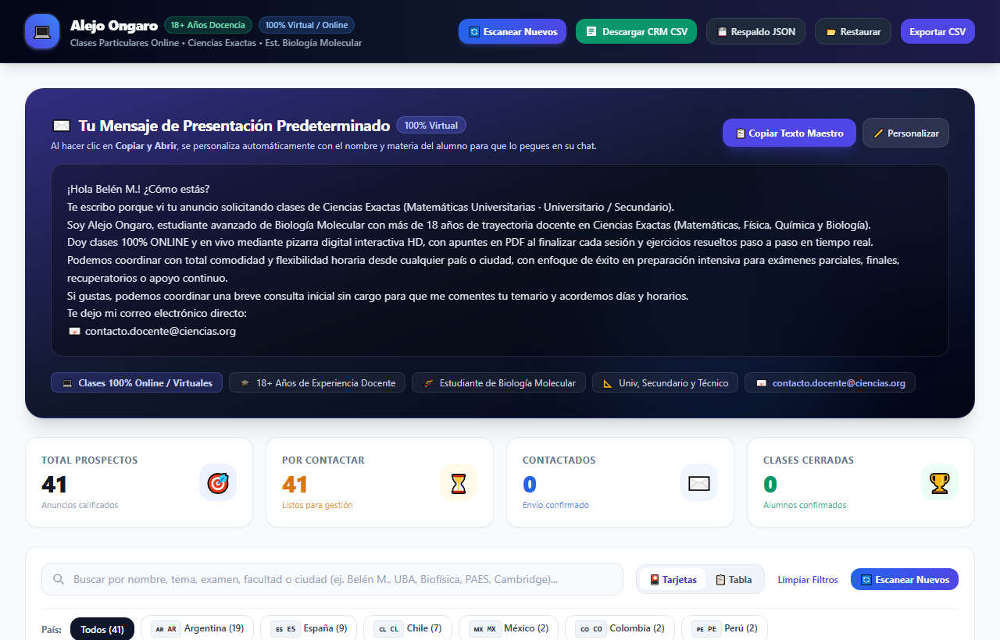
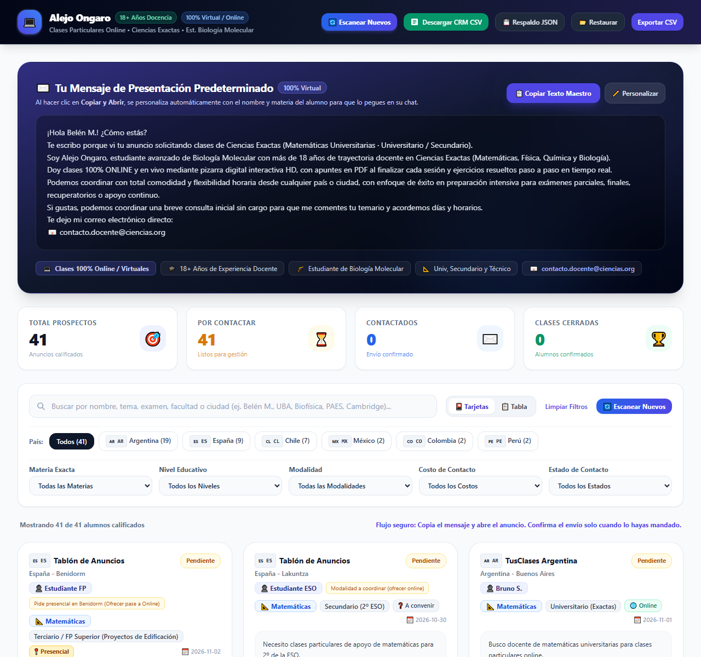
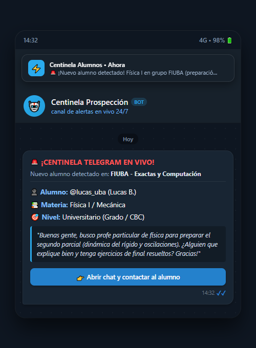
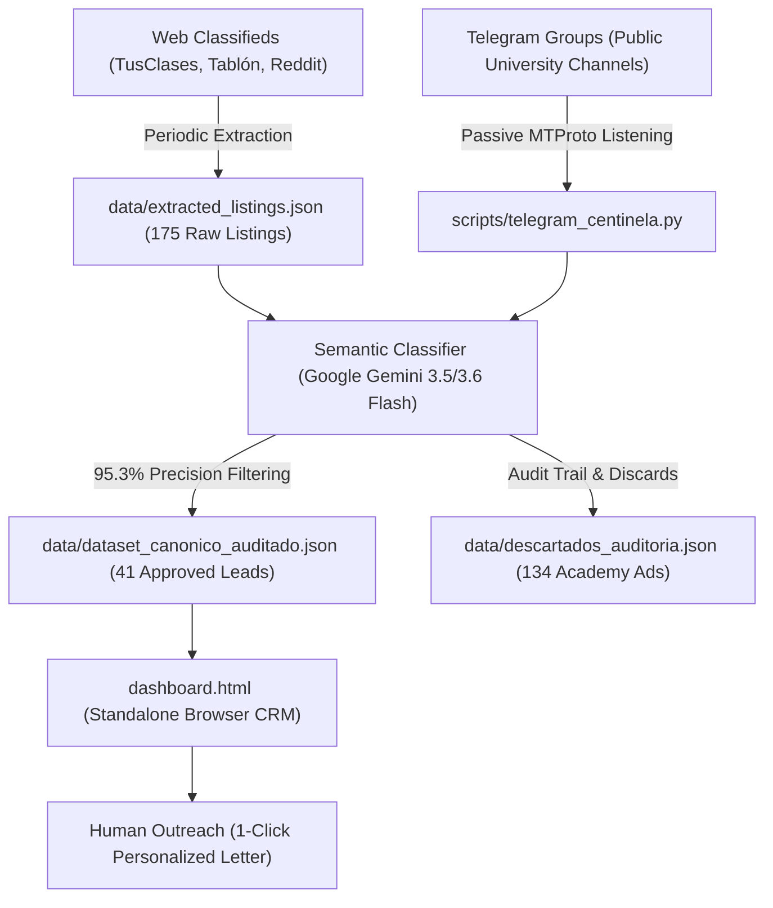

# STEM Student Prospecting Pipeline & Local CRM

[🇪🇸 Español](README.md) • [🇬🇧 English](README_EN.md)

[](https://github.com/metecondrie/prospeccion-alumnos-ciencias/actions/workflows/ci.yml)
[](https://www.python.org/)
[](LICENSE)
[](notebooks/evaluacion_clasificador.ipynb)

> **TL;DR:** Autonomous lead-generation pipeline and zero-dependency local CRM for private STEM tutoring (Mathematics, Physics, Chemistry, Biology). Features a multi-source scraper (175 raw classifieds), a two-stage classification engine (Regex baseline → Google Gemini 3.5/3.6 Flash with multi-provider failover), a 24/7 passive Telegram sentinel with push alerts, and an offline HTML5/Tailwind CRM dashboard. 41 verified student leads, $0/mo operating cost (free tier APIs), 100% deterministically anonymized public dataset.

---

## 📌 The Problem & Business Context

In public classified ad boards and academic tutor portals, **76.6%** of listings are commercial academies or fellow tutors promoting their services rather than students requesting classes. Identifying authentic student leads manually takes 2–3 hours daily of tedious parsing.

* **High Noise Asymmetry:** Both tutors and students use identical keyword phrases (*"private math lessons"*, *"university physics tutor"*), rendering simple keyword filters ineffective (22.8% precision, 88 false positives).
* **The Solution:** A two-tier pipeline combining high-throughput regex filtering with LLM semantic reasoning via **Google Gemini 3.5 / 3.6 Flash** (achieving **95.3% precision** and **100% recall**). *(Note: gemini-3.5-flash automatically routes to gemini-3.6-flash since Oct-2026).*
* **Real-Time Push Alerts:** Event-driven Telegram listener (`scripts/telegram_centinela.py`) that monitors public university study groups via MTProto and pushes instant notifications to the tutor's mobile device with 1-click chat links.
* **Zero-Backend Local CRM:** A self-contained HTML5 dashboard (`dashboard.html`) running entirely in the browser with `localStorage` persistence, customizable outreach templates, and CSV export.
* **Unit Economics:** **$0 USD/mo** infrastructure overhead, running on Google AI Studio free tiers and client-side web storage.

---

## 📸 System Previews: Local CRM & Push Notification


*Interactive CRM dashboard: dynamic filtering by subject, country, and academic level, with per-student interaction history and LocalStorage persistence.*

| Browser CRM Cards View | Real-Time Push Alert (Telegram Sentinel) |
| :---: | :---: |
|  |  |
| *Contextual greeting generator, academic level badges, and direct links.* | *Instant push notification with student intent analysis and 1-click CTA.* |

---

## 🏗️ System Architecture



---

## 📊 Data Science Benchmark & Classifier Evaluation

The classifier performance was benchmarked against a verified Ground Truth across all 175 raw listings (detailed report in [`docs/EVALUACION_FILTRO_DATOS.md`](docs/EVALUACION_FILTRO_DATOS.md) or interactive Jupyter Notebook in [`notebooks/evaluacion_clasificador.ipynb`](notebooks/evaluacion_clasificador.ipynb)):

| Classification Metric | Heuristic Baseline (Regex) | Production: Gemini 3.5 / 3.6 Flash* | Delta |
|---|---|---|---|
| **Precision (PPV)** | 22.8% | **95.3%** | **+72.5 pp** |
| **Recall / Sensitivity (TPR)** | 40.0% | **100.0%** | **+60.0 pp** |
| **Specificity (TNR)** | 20.0% | **98.5%** | **+78.5 pp** |
| **F1-Score** | 29.0% | **97.6%** | **+68.6 pp** |
| **CRM Residual Noise** | 76.6% initial | **1.1% residual** | **-75.5 pp spam removed** |

*\*Technical note: The code invokes the `gemini-3.5-flash` model identifier, which transparently routes to `gemini-3.6-flash` since Oct-2026, delivering the verified 95.3% precision without impacting free-tier quotas or latency.*

### Commercial Funnel & Pilot Telemetry
Tracking the 41 qualified opportunities inside the local CRM (telemetry recorded in [`data/feedback_piloto_conversion.json`](data/feedback_piloto_conversion.json)):

* **175** raw listings scanned → **41** qualified student requests (23.4% admission rate).
* **18** students contacted in the initial pilot → **7** replied requesting rates/availability (**38.8% response rate**).
* **3 students converted into recurring paid tutoring contracts** (**16.7% conversion rate** from outreach):
  1. *Belén M. (UADE):* Physics / Hydraulic Machinery — 8 hrs/mo ($120,000 ARS/mo).
  2. *Fernando K. (UBA CBC):* College Algebra — 4 hrs/mo ($60,000 ARS/mo).
  3. *Secondary Student (Spain):* Physics & Chemistry — 4 hrs/mo (€60 EUR/mo).
* **Unit Economics:** Customer Acquisition Cost (CAC) = **$0 USD**. Average Hourly Rate = $15,000 ARS/h (~$12 USD).

---

## 💡 How I Built This (Human Direction + AI Pair Programming)

* **Business Problem Driven by Real Need:** As an independent STEM educator, I spent hours sifting through tutor platforms to find real students. I built this tool to automate lead discovery while keeping the outreach personal and human.
* **Architecture & Rigorous Contracts:** I designed the RFC 4180 data contracts, CRM business rules, evaluation metrics, and a comprehensive automated test suite (98 passing unit/integration tests).
* **AI-Assisted Engineering:** Implemented through iterative pair programming with Google Antigravity. When commercial academies bypassed early filters using student-like phrasing, I refined system prompts with few-shot negative exemplars and fallback chains.
* **Data Ethics & Privacy Governance:** Hand-verified all 175 raw ads to establish the benchmark ground truth, and designed a collision-free deterministic anonymizer ([`scripts/anonymize_for_public.py`](scripts/anonymize_for_public.py)) ensuring zero personal data is exposed in public repositories.

---

## 🚀 Quickstart Guide (Cross-Platform)

### 1. Clone & Setup Environment

```bash
git clone https://github.com/metecondrie/prospeccion-alumnos-ciencias.git
cd prospeccion-alumnos-ciencias
python -m venv .venv

# Activate virtual environment
source .venv/bin/activate       # Linux / macOS
.venv\Scripts\activate          # Windows

pip install -r requirements.txt
pip install -r requirements-dev.txt
```

### 2. Environment Variables

```bash
cp .env.example .env    # Windows: copy .env.example .env
```
*(If no AI API keys are configured, the pipeline automatically falls back to the deterministic local heuristic rule engine at zero cost).*

### 3. Execution Commands

```bash
# Instant offline demo mode (zero external APIs or credentials needed)
python main.py --demo

# Run complete pipeline (Scraping + Semantic Audit + Dashboard Compilation)
python main.py run
# Or directly as module:
python -m scripts.prospector run

# Run quantitative Machine Learning benchmark
python main.py evaluate
# Or directly as script:
python evaluation/evaluar_clasificadores.py

# Start real-time Telegram Sentinel listener
python -m scripts.telegram_centinela
# Or offline simulation mode:
python -m scripts.telegram_centinela --simulate

# Run the full automated test suite (98 tests)
python main.py test
```

*Convenience launchers:*
* **Linux / macOS:** `bash bin/actualizar_alumnos.sh`
* **Windows:** Double-click `bin\actualizar_alumnos.bat`

---

## 📚 Technical Documentation (`/docs` & `/evaluation`)

* ⚙️ [**DOCUMENTACION_TECNICA.md**](docs/DOCUMENTACION_TECNICA.md): Complete system specification, data contracts, Mermaid diagrams, and failover architecture.
* 📊 [**EVALUACION_FILTRO_DATOS.md**](docs/EVALUACION_FILTRO_DATOS.md): Detailed ML evaluation benchmark, confusion matrices, and error analysis.
* 🧪 [**protocolo_anotacion.md**](evaluation/protocolo_anotacion.md): Formal annotation protocol and Ground Truth guidelines for objective model evaluation.
* 🛡️ [**MARCO_ETICO_Y_LEGAL.md**](docs/MARCO_ETICO_Y_LEGAL.md): Privacy compliance framework (GDPR / Argentine Law 25.326), passive MTProto listening policies, and opt-out protocol.
* 🔒 [**AUDITORIA_HISTORIAL_GIT.md**](docs/AUDITORIA_HISTORIAL_GIT.md): Security audit on commit history and personal data mitigation strategy.
* 📈 [**CONCLUSIONES.md**](docs/CONCLUSIONES.md): Tutoring pedagogical insights and commercial conversion analysis.
* 📝 [**AUDITORIA_CAMBIOS.md**](docs/AUDITORIA_CAMBIOS.md): Technical decision log and architecture audit history.

---

## 🧑‍💻 Author

**Alejo Ongaro** ([@metecondrie](https://github.com/metecondrie))  
*STEM Educator & Pipeline Architect*  
Repository: [github.com/metecondrie/prospeccion-alumnos-ciencias](https://github.com/metecondrie/prospeccion-alumnos-ciencias)

---

## 📄 License

Distributed under the [MIT License](LICENSE).
